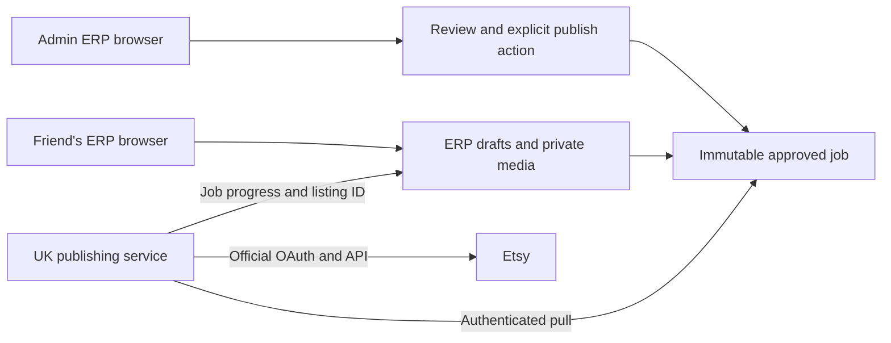

# Etsy listing workspace

Design and initial implementation, 25 November 2026.

## Owner's workflow

Syed Ali Abbas prepares listings for the owner's shop using his existing service-taker account. He does not connect a separate shop. An administrator can enable or revoke **Etsy listing access** under **Service Takers → Edit → Portal services**. Revocation is enforced on every draft, attachment and workspace request; it preserves existing work for administrators.

`Draft → In review → Approved → [publishing connection required]`

An administrator can return a submission with a message or reopen an approved draft. Submitted and approved drafts cannot be edited until reopened. Changes increment a revision; stale writes return a conflict instead of overwriting another editor's work. Approval in this first release is approval of preparation, not a promise that Etsy will accept the listing.

## Implemented initial workspace

- Tenant-scoped draft storage, private attachments, activity history and basic schema validation.
- The service taker sees only their own drafts. Company administrators see the company's drafts.
- Positive access grant through `Service Etsy Listings`; ordinary workers and other service takers cannot enter.
- Administrators get `Etsy Listings`. Only administrators can approve, return or reopen.
- Draft saving permits incomplete content. Submission allows the administrator to review missing fields; approval checks required base listing fields. The UI distinguishes those checks from future Etsy validation.
- No browser requests, embedded images, scripts, analytics or OAuth calls to Etsy from this workspace. Uploaded assets are served through authenticated ERP endpoints; credentials are never requested from the preparer.
- The publishing action is disabled and the API returns 503. No OAuth, outgoing Etsy requests, automatic posting, or credential storage are implemented in this release.

## Field coverage

The official OpenAPI specification was captured on 25 November 2026 in `backend/app/etsy/fields.json`. Regenerate it with `scripts/build-etsy-field-catalog.py` using a freshly downloaded official specification. The field inventory covers ten listing operations, not all shop-management settings in Etsy Seller Manager.

| Editor section | Inputs covered |
|---|---|
| Product details | Title, description, physical/digital type, maker, production era, supply/custom-order flags, taxonomy, materials, tags, styles, shop section, production partners |
| Photos and files | Private image/video/digital uploads, order/rank, alt text, existing media references, overwrite/watermark flags, file names, variation-to-image mapping |
| Price and variants | Base price and quantity, SKU, product option values and scales, per-offering price/quantity/enabled/processing profile, properties controlling price/quantity/SKU/processing, renewal and taxation |
| Category attributes | Repeatable property reference, values/value references and measurement scale; populated category choices require the future catalog sync |
| Shipping and returns | Shipping profile, processing profile, return policy, processing bounds, weight/dimensions and units |
| Personalization | Question text/type/instructions, required flag, character/file limits, options, optional add-on price and existing question/option references |
| Safety and guarantees | Manufacturer and EU responsible-person references/types, serial/batch identifiers, warnings, guarantee brand/model/duration/terms, other guarantees, after-sales and software-support information |
| Translations | Language, translated title, description and tags |

Shop/category selectors currently accept reference values and explain the missing connection. This is not yet a complete replacement for Etsy Seller Manager. Production-partner creation, economic-operator records, shipping/profile management and any fields unavailable through Etsy's API must be configured in the shop or added through their separate endpoints. Do not fabricate IDs or infer eligibility.

The current personalization schema advertises several question types but documents only a single `text_input` question as supported. The publisher must capability-gate unsupported combinations even though the preparation form captures the schema. Media format and size limits in the ERP are preparation limits; perform Etsy's current validation before sending.

## UK publishing service design — next stage

Owner-provided host: `5.226.52.171:49166`. The port's protocol and access have not yet been verified. Do not assume it is an HTTPS API or SSH endpoint. The ERP VPS is separately hosted at `167.94.158.70`.

The publisher should initiate authenticated outbound pulls from the UK host, so no new public inbound publishing endpoint is required. Every Etsy call, including token refresh, taxonomy/profile synchronization, media transfer and listing activation, runs on that host. The main ERP backend must not fall back to making those calls itself. Do not forward the preparer's IP, cookies, browser headers or ERP session to Etsy. This architecture controls the source of API traffic, not Etsy's other account signals or seller eligibility.

### Connection and credentials

1. Confirm the UK server and install a supervised service with restricted OS permissions.
2. Register/approve an Etsy developer application for the shop and exact HTTPS redirect URI.
3. Admin authorizes the shop using OAuth authorization-code flow with PKCE and a one-use, expiring state value bound to the admin and shop. The friend's account cannot start or finish OAuth.
4. Encrypt refresh/access tokens on the publishing server using a deployment-managed key. Never put them in ERP draft payloads, frontend bundles, local storage, logs or screenshots.
5. Verify the returned shop identity, access scopes and fixed outgoing IP before marking the connection ready. `listings_r`, `listings_w` and relevant shop-read scopes must be checked against actual endpoints. Renew tokens atomically; redact failures.
6. Synchronize seller taxonomy, category properties/scales/values, shop currency/sections, shipping and readiness profiles, return policies, production partners and economic operators into a tenant/shop-scoped cache. Serve choices to ERP browsers from that cache only.

### Publish reliability

- Publish is an authenticated admin command, separately authorized from approval. Show the final content, shop and listing-fee notice before activation.
- Atomically snapshot content, attachment hashes and revision; queue one unique job per shop/draft/revision. Prevent double-clicks and concurrent workers through job leases and uniqueness constraints.
- Create an Etsy **draft** first; persist its listing ID before subsequent work. Upload and map private files, apply properties, inventory, translations, personalization and variation images. Validate all applicable shop/category/physical/digital/GPSR conditions. Activate only after every required step succeeds.
- On ambiguous create timeouts, stop for reconciliation; never blindly repeat creation. After a listing ID is known, resume against that ID with recorded step checkpoints. Respect Etsy rate-limit headers and 429 backoff.
- Fetch the finished listing and verify its state/URL before showing **Published**. Preserve actionable redacted errors and a recoverable partial-draft state.
- Reopening changes invalidates approval and any unclaimed job. Disable new publishing when connection verification or token refresh fails. No alternate-host fallback.
- Disabling a preparer's access prevents further reads/writes immediately. It does not delete submitted work or implicitly authorize publishing it.

## Validation and rollout

Backend tests cover ownership/tenant separation, revoked access, private downloads, revision conflicts, workflow transitions and publishing disabled without connection. Browser smoke checks cover form saves, all sections, admin/service-taker controls, mobile overflow and absence of external requests. No real Etsy account was used for these checks.

Before enabling real publishing: exercise OAuth, cache refresh, file validation, category-dependent fields, retry/reconciliation, duplicate prevention and sandbox/draft operations against the actual authorized shop. Include private asset storage in encrypted backups and retention procedures; the existing public-upload backup does not automatically cover `APP_DATA_DIR/etsy_listing_assets`.

Sources: [Official OpenAPI specification](https://www.etsy.com/openapi/generated/oas/3.0.0.json), [listing workflow](https://developers.etsy.com/documentation/tutorials/listings/), [OAuth](https://developers.etsy.com/documentation/essentials/oauth2/), [personalization migration](https://developers.etsy.com/documentation/tutorials/personalization-migration/).
